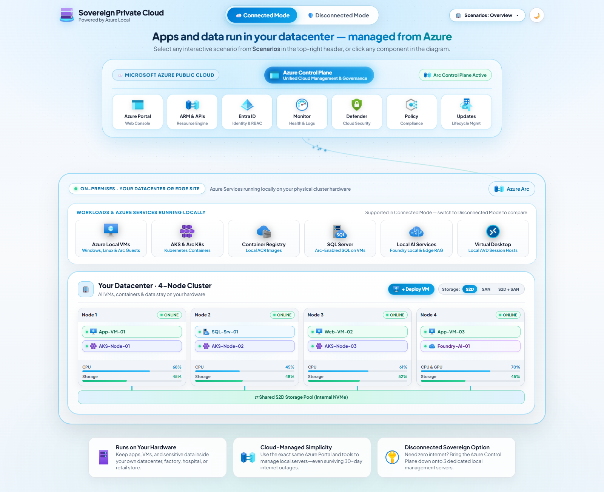
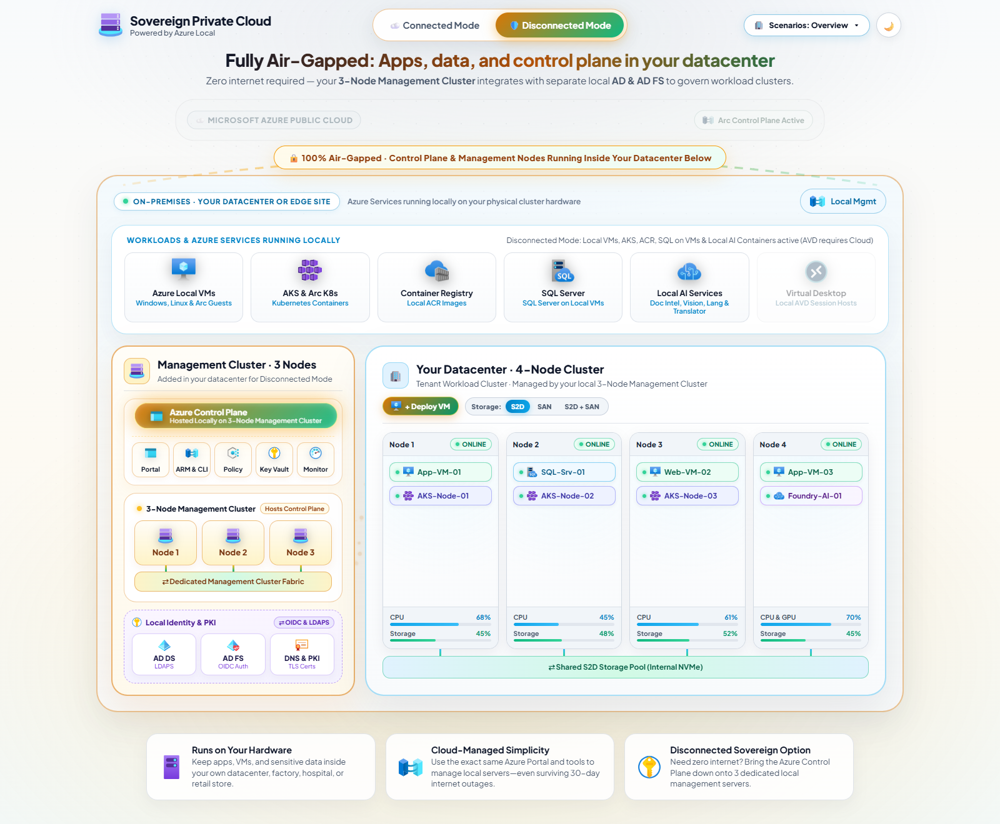
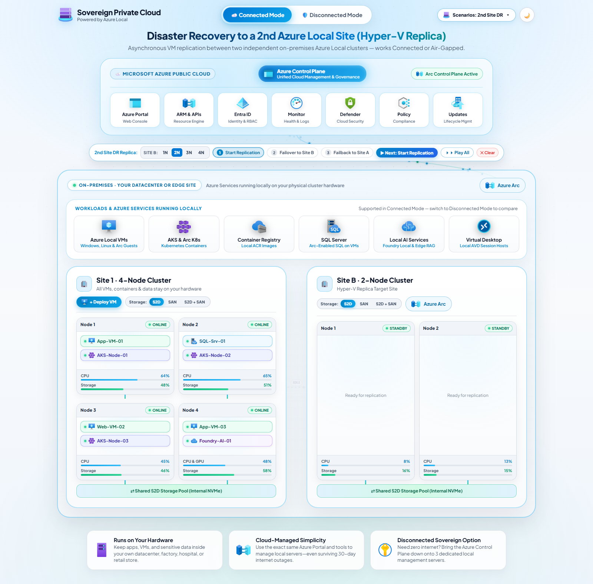

<p align="center">
  
</p>

<h1 align="center">Azure Local Experience</h1>

<p align="center">
  Explore hybrid cloud, disconnected operations, and resiliency through an interactive architecture demo.
</p>

<p align="center">
  <a href="https://shaunjacob.github.io/azure-local-experience/"><strong>Launch the interactive experience</strong></a>
  &nbsp; | &nbsp;
  <a href="#scenario-guide">Scenario guide</a>
  &nbsp; | &nbsp;
  <a href="#run-locally">Run locally</a>
</p>

[](https://shaunjacob.github.io/azure-local-experience/)

## See the architecture. Change the scenario.

Azure Local Experience turns architecture conversations into a hands-on,
browser-based walkthrough. Switch between cloud-connected and disconnected
management, introduce failures, and follow how the illustrated workloads,
storage, and control plane respond.

Built for architecture discussions, learning sessions, and live demonstrations.
No Azure subscription, account sign-in, backend, or build step is required.

> **An educational simulation, not a deployment tool.** Workloads, utilization,
> failures, and recovery are simulated in your browser. The diagrams and timing
> labels are illustrative, not a support matrix, SLA, or production sizing
> guidance. Validate real deployments against current
> [Azure Local documentation](https://learn.microsoft.com/azure/azure-local/).

## Two ways to explore

| Connected architecture | Disconnected architecture |
| --- | --- |
| Explore local workloads with Azure-hosted management and Azure Arc in the diagram. | See management move into a dedicated local three-node management cluster, alongside local identity services. |
| Compare local operations with cloud-based governance and recovery scenarios. | Explore the visual distinction between an internet outage and a deliberately disconnected design. |

### Disconnected management, in view



### Two sites, one recovery story



## Scenario guide

Choose **Scenarios** in the top-right corner. Where available, use **Next** to
step through a scenario or **Play All** for a guided sequence.

| Scenario | What you can explore |
| --- | --- |
| Single-Site Overview | A four-node cluster, illustrated local workloads, VM placement, and S2D/SAN storage choices. |
| Internet Outage | Interrupt the illustrated WAN connection and compare local workloads with cloud management availability. |
| Node Failure (HA) | Click a server to simulate failure and watch workload recovery on remaining nodes. |
| Cloud DR (Site Recovery) | Walk through illustrated replication, failover to Azure, and failback. |
| 2nd Site DR Replica | Configure a one-to-four-node secondary site and step through Hyper-V Replica recovery. |
| Rack-Aware Cluster | Explore a cluster spanning two zones, storage choices, and zone-failure recovery. |
| Update Manager | Follow a rolling update sequence with workload migration, patching, and node reboots. |
| Unified Azure Policy | Walk through simulated guest OS auditing, remediation, and configuration drift. |

Internet Outage, Cloud DR, and Update Manager are connected-only scenarios in
this demo. Choosing one from disconnected mode switches the experience back to
connected mode.

## Try a five-minute walkthrough

1. Launch the experience and explore **Single-Site Overview**. Click diagram
   components for explanations, deploy an illustrated VM, and compare storage
   options.
2. Switch to **Disconnected Mode** to see how the management layout changes.
3. Choose **Node Failure (HA)** and click a server to simulate an outage.
4. Choose **2nd Site DR Replica**, start replication, and step through failover
   and failback.
5. Try **Update Manager** or **Unified Azure Policy** for an operations-focused
   walkthrough. Use the theme button to switch between light and dark views.

## Run locally

Clone or download this repository, then open the root `index.html` in a modern
desktop browser. Keep `app.js`, `styles.css`, and `icons/` alongside it.

```text
index.html       Application entry point
app.js           Scenario logic, interactions, and animation
styles.css       Layout, themes, and visual styling
icons/           SVG service and infrastructure icons
docs/images/     Actual application screenshots used in this README
```

The app uses plain HTML, CSS, JavaScript, and a canvas animation layer. Google
Fonts is requested when available; the stylesheet also defines fallback fonts.

## Hosting with GitHub Pages

**Live site:** https://shaunjacob.github.io/azure-local-experience/

This repository publishes directly from **`main` / `/ (root)`**. GitHub Pages
serves `index.html` as the entry point, with the adjacent JavaScript, CSS, and
icons. It does not serve this README as the application homepage.

To reproduce the setup in a fork:

1. Open **Settings > Pages**.
2. Under **Build and deployment**, choose **Deploy from a branch**.
3. Select **main** and **/ (root)**, then click **Save**.
4. Wait for the **pages build and deployment** run to complete, then use the
   site link shown in Pages settings.

Future pushes to `main` publish automatically. No custom deployment workflow,
cross-repository token, or Azure hosting resource is needed for Pages. If a
change does not appear, check the Pages deployment run and refresh your browser.
GitHub Pages publishes a public website; do not include secrets in site files.

<details>
<summary>Optional: cross-repository index.html sync (separate from Pages)</summary>

The existing `Sync index.html` workflow is independent of website hosting.
It runs on pushes to `main`, or manually, and copies only the root `index.html`
to `Azure/azure-local-experience` on `main`. It creates a destination commit only
when that file differs; it does not copy `app.js`, `styles.css`, or `icons/`.
The destination must maintain compatible assets separately.

It requires the source repository's `DESTINATION_REPO_TOKEN` Actions secret:
a fine-grained personal access token with resource owner `Azure`, access limited
to `azure-local-experience`, and **Contents: Read and write** permission. Its
owner must have destination write access and any required organization approval.
Add it under **Settings > Secrets and variables > Actions**. Destination rules
must allow the owner's direct pushes; rotate the secret before its token expires.

Without that secret the sync workflow fails explicitly, but Pages deployment
is separate and does not depend on it.

</details>
